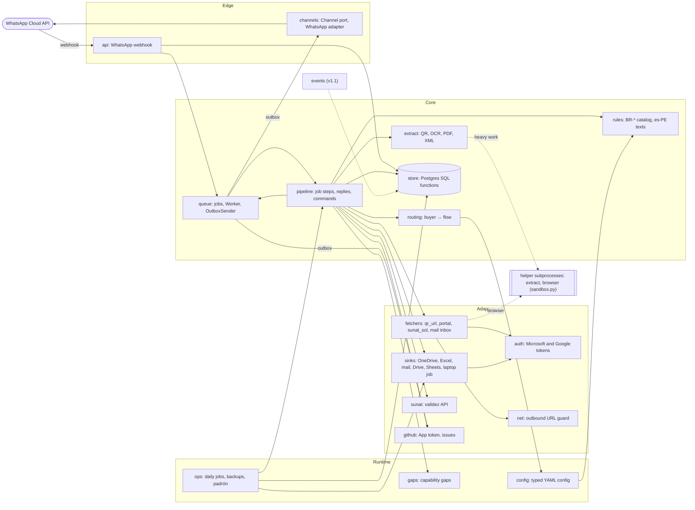
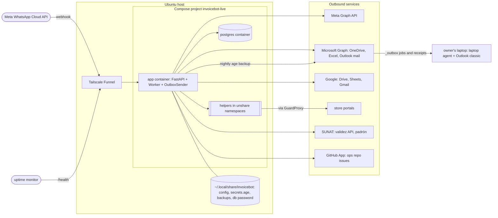

# Architecture

This page shows how the bot fits together, drawn from the code. It is a view of
[the design spec](../specs/03-design.md), not a second source of truth: when the
two disagree, the spec decides and the drawing is fixed (D161).
`tests/unit/test_docs.py` fails when a package or an invoice state is missing
from the diagrams.

Business rules and the user messages are in
[spec 06](../specs/06-business-rules.md), and how to run the live host is in
[the deploy guide](../deploy/README.md).

## Components

One Python process (FastAPI + asyncio) and Postgres. Arrows point from the
caller to what it uses; the import contracts in `.importlinter` keep them
pointing inward.

| Package    | Job                                                                                    |
| ---------- | -------------------------------------------------------------------------------------- |
| `api`      | WhatsApp webhook routes: handshake, signature check, intake (R-1.2); REST/MCP in v1.1. |
| `channels` | Channel adapters and the canonical channel port (PT-1).                                |
| `queue`    | Durable jobs with leases and backoff, the `Worker`, the `OutboxSender` (S1.4).         |
| `pipeline` | The job steps, chat replies and commands that move an invoice through its states.      |
| `routing`  | Picks the flow for an invoice from its buyer and the configured rules (R-3.1).         |
| `rules`    | Business-rule catalog and es-PE user messages (spec 06).                               |
| `extract`  | Pure reading and checking of invoice data: QR payloads, images, PDF and XML.           |
| `store`    | Postgres: the connection pool and one module of SQL functions per table group.         |
| `fetchers` | Get an invoice's official PDF and XML (R-5.1).                                         |
| `sinks`    | Where a filed invoice goes: OneDrive folder, Excel, mail, Drive, Sheets.               |
| `sunat`    | The SUNAT validez API client.                                                          |
| `github`   | GitHub writes for capability gaps: the App token, the issue text, the transport.       |
| `auth`     | Sign-in and token caches for the accounts the sinks use (R-7.9).                       |
| `net`      | Outbound request guard: pure URL and address checks (R-5.10).                          |
| `config`   | Typed runtime configuration (R-9.6).                                                   |
| `ops`      | Scheduled operations: the daily task loop, backups, housekeeping, padrón (R-9.11).     |
| `gaps`     | Deduplicated missing capabilities that need a repository change (spec 06 §3).          |
| `events`   | Signed event webhooks to subscribers; a placeholder until v1.1.                        |

Two rules shape the arrows:

- **The outbox.** Nothing sends to a channel or to GitHub directly. A state
  change, its next job and its outgoing message are written in one transaction;
  the `OutboxSender` sends later and retries.
- **Helpers.** OCR, PDF rendering and the Playwright browser run as short-lived
  subprocesses (`helper.py`, `sandbox.py`), one at a time (the `HEAVY`
  semaphore), so the main process stays small. Portal traffic from the browser
  goes through `GuardProxy`, which applies the `net` checks.

## Deploy topology (local MVP host)

The MVP runs on the owner's Ubuntu machine (D141) as the rootless Podman
Compose project `invoicebot-live` (D148). Meta reaches it through Tailscale
Funnel (D146); the helpers run in `unshare` namespaces inside the app
container (D147).

- The laptop agent never talks to the bot directly. The bot drops signed
  `laptop_outlook` jobs in the personal OneDrive `_outbox/`; the agent sends
  them through Outlook classic and writes signed receipts back (R-7.14).
- Backups are `age`-encrypted before they leave the host (D119).
- `/health` answers 200 or, with Postgres down, 503 (R-9.14, R-9.15).
